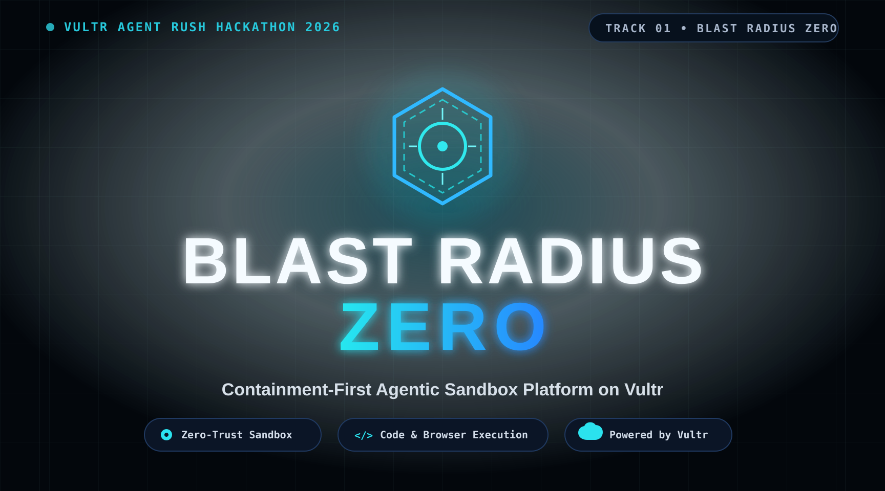

# Blast Radius Zero



> **Blast Radius Zero executes untrusted agent code and browser actions inside ephemeral, resource-capped containers on Vultr.** The current implementation uses Docker isolation; a Native-powered sub-10ms runtime is planned, not yet shipped.

Blast Radius Zero is a containment-first execution layer built for the Vultr Agent Rush Hackathon 2026. Models can propose Python or bounded browser work, but deterministic control-plane code owns validation, networking, resource limits, human approval, evidence collection, and teardown.

**Live demo status:** public deployment and live Vultr Inference verification are pending. Presets and the tested Python containment path are available from the repository. See [Testing and evidence](TESTING.md) for the exact verified scope.

## Why it exists

- **Process isolation:** submitted Python never runs in the API or on the host process.
- **Secret hygiene:** provider credentials and the Docker socket are not passed to execution sandboxes.
- **Resource hardening:** CPU, memory, PID, output, artifact, and deadline limits are enforced by trusted code and the container runtime.
- **Controlled browser egress:** Playwright reaches allowlisted HTTPS destinations through a per-run proxy and host destination policy.
- **Human approval:** form preparation and submission use separate browsers, an expiring approval, and a payload-bound permit.
- **Ephemeral lifecycle:** task containers and networks are removed after success, failure, cancellation, or timeout.

## Architecture

```text
User request
    │
    ▼
Web dashboard (Next.js) ───────► Core API (FastAPI) ───────► Redis
                                      │                       tasks, quotas,
                                      │                       approvals, artifacts
                                      ▼
                            Trusted coordinator ───────► Vultr Inference
                             (Docker socket owner)        when enabled
                                  │          │
                                  ▼          ▼
                         Python sandbox   Browser sandbox ──► Squid allowlist
                         network disabled   isolated network   + host filtering
                                  │          │
                                  └────┬─────┘
                                       ▼
                              Evidence and teardown
```

The intended production host is a dedicated Ubuntu 24.04 Vultr Cloud Compute VM. Docker is software on that VM, not a separate Vultr-managed sandbox. Read [Architecture and trust boundaries](docs/ARCHITECTURE.md) before changing execution or deployment policy.

## Quick start

### Prerequisites

- Ubuntu 24.04 or another Linux development host
- Docker Engine 28+ with the Compose plugin
- Python 3.13+ for core checks
- Node.js 24+ for web checks
- A Vultr Inference subscription key only if live AI is enabled

### Configure and build

```bash
git clone https://github.com/W4sP4nx2/blast-radius-zero.git
cd blast-radius-zero
cp .env.example .env
chmod 600 .env

# Edit APP_DOMAIN, DEMO_DOMAIN, DEMO_IP, and BROWSER_DOMAINS.
# Leave AI_ENABLED=false unless Vultr Inference is configured.
docker compose --profile images build
docker compose up -d
```

For a public VM, install the checked-in host egress policy before enabling browser tasks, then run preflight:

```bash
sudo ./deploy/install-firewall.sh --demo-ip YOUR_VM_PUBLIC_IP --dns 1.1.1.1
./deploy/preflight.sh
```

The firewall script changes BRZ-owned host policy. Review it before running it. Full DNS, TLS, local-development, and verification instructions are in [Setup and operation](docs/SETUP.md).

### Validate without deploying

```bash
python3.13 -m venv .venv
.venv/bin/pip install -r core/requirements-dev.txt
PYTHONPATH=core .venv/bin/python -m pytest core/tests -m 'not integration' --fail-on-skip

cd web
npm ci
npm run typecheck
npm run build
```

## Execution patterns

### Sandboxed code

1. A user submits Python directly or asks the model to propose it.
2. Pydantic validates the bounded plan before dispatch.
3. The coordinator starts an unprivileged container with no external network, a read-only root filesystem, and fixed resource limits.
4. Logs and bounded artifacts are returned, then the container is removed.

### Sandboxed browser automation

1. The model selects from fixed Playwright operations; it cannot submit arbitrary JavaScript.
2. Chromium runs in an isolated container network through Squid.
3. Screenshots, source URLs, and trusted policy events become task evidence.
4. Side effects require explicit approval and a fresh-browser revalidation step.

## Known limitations and design trade-offs

| Area | Current boundary | Mitigation or direction |
| --- | --- | --- |
| Cold-start latency | Docker image and container startup adds initial overhead. Native sub-10ms isolation is not integrated yet. | Keep Vultr host nodes warm; evaluate a Native runtime adapter without weakening the policy contract. |
| State persistence vs. zero trust | Sandbox filesystem changes are destroyed after each stage by design. | Stream approved artifacts to bounded external storage before teardown. |
| Browser headless constraints | Heavy WebGL, canvas, GPU, and GUI workflows can fail or render incompletely in containerized Chromium. | Keep workflows bounded; use explicit viewport/framebuffer settings and fail closed on missing evidence. Xvfb is a possible compatibility path, not current verified behavior. |
| Host-kernel boundary | Docker containers share the Vultr VM kernel. | Use non-root identities, dropped capabilities, seccomp, read-only filesystems, host egress controls, and a dedicated VM. This is not a proof of zero host risk. |
| Browser scope | The browser supports fixed, allowlisted operations rather than arbitrary authenticated browsing. | Account logins, payments, purchases, and third-party form submissions remain out of scope. |
| Scale and availability | One coordinator owns process-local concurrency controls. | Do not add workers until admission and leases are made distributed. |
| Live service status | Public HTTPS deployment, browser host-policy checks, and live Vultr Inference remain unverified. | Run `deploy/preflight.sh` and retain sanitized target-host evidence before changing this status. |

## Repository structure

```text
blast-radius-zero/
├── core/          # Trusted API, planning, orchestration, policy, and tests
├── sandbox/       # Python and Playwright runtime images and profiles
├── web/           # Next.js dashboard
├── deploy/        # Vultr-host TLS, proxy, firewall, and preflight policy
├── docs/          # Architecture, setup, and participant documentation
├── verification/  # Sanitized evidence from completed checks
├── .env.example   # Safe configuration template; no credentials
├── compose.yaml   # Local and single-host service topology
└── README.md      # Project overview, status, and quick start
```

## Security configuration

Copy `.env.example`; never commit `.env`, provider tokens, SSH keys, or private key files. The application reads `VULTR_API_KEY` only in the trusted core service. `NATIVE_API_KEY` is reserved for a future optional adapter and is not consumed by the current runtime.

If a real credential has ever been committed, deleting the file in a new commit is insufficient. Revoke and rotate the credential first, then rewrite history with a reviewed tool such as `git filter-repo` and coordinate a fresh clone for every contributor.

## Documentation

- [Architecture and trust boundaries](docs/ARCHITECTURE.md)
- [Setup and operation](docs/SETUP.md)
- [Implementation contract](IMPLEMENTATION.md)
- [Testing and retained evidence](TESTING.md)
- [Security and demo checklist](CHECKLIST.md)
- [Scaling and SDLC](SCALING_AND_SDLC.md)

## License

[MIT](LICENSE). Built for the Vultr Agent Rush Hackathon 2026.
