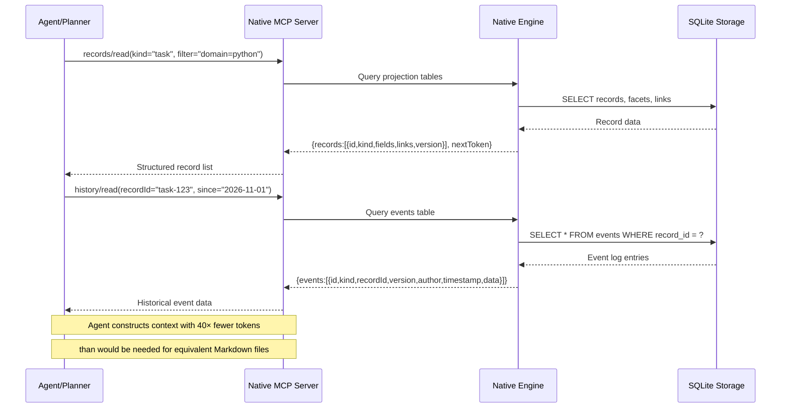
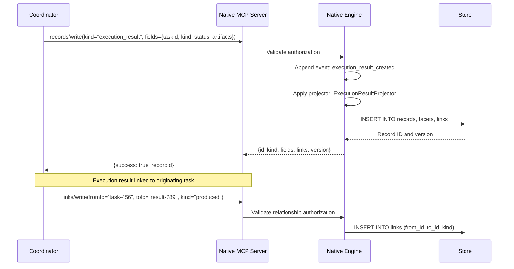

# Native Integration with Blast Radius Zero

This document describes how Native's record-based workspace integrates with Blast Radius Zero's control plane and execution sandbox architecture.

## Overview

Native serves as an **agent-native context engine** that provides structured, queryable workspace data to Blast Radius Zero's AI orchestration layer. Instead of relying on unstructured Markdown files that agents must read and parse, Native exposes a typed, relational data model through an MCP (Model Context Protocol) server that Blast Radius Zero can consume for task planning and execution.

### Key Integration Points

```
┌─────────────────────────────────────────────────────────────────────────────┐
│                    BLAST RADIUS ZERO CONTROL PLANE                          │
│  ┌──────────────┐  ┌──────────────┐  ┌──────────────────────────────────┐  │
│  │   Next.js    │  │   FastAPI    │  │    Trusted Coordinator           │  │
│  │  Dashboard   │  │     API      │  │    (Docker socket owner)         │  │
│  └──────┬───────┘  └──────┬───────┘  └───────────────┬──────────────────┘  │
│         │                 │                          │                      │
│         │  HTTP/REST      │  HTTP/REST               │  Docker API          │
│         │                 │                          │                      │
│  ┌──────┴───────┐  ┌──────┴───────┐  ┌───────────────┴──────────────────┐  │
│  │   Redis      │  │   Store      │  │  ┌──────────────────────────────┐ │  │
│  │ (state,      │  │   (SQL)      │  │  │  Python Sandbox              │ │  │
│  │  counters)   │  │              │  │  │  - External network OFF        │ │  │
│  └──────┬───────┘  └──────┬───────┘  │  │  - 256 MiB / 0.5 CPU / 10s     │ │  │
│         │                 │          │  └──────────────────────────────┘ │  │
│         │                 │          └─────────────────────────────────────┘  │
│         │                 │                                                   │
│         │                 │          ┌──────────────────────────────────────┐ │
│         │                 │          │  Browser Sandbox                     │ │
│  ┌──────┴───────┐  ┌──────┴───────┐  │  - Internal network (Squid proxy)  │ │
│  │   Native     │  │   MCP Tools  │  │  - 512 MiB / 1 CPU / 30s           │ │
│  │  (MCP       │  │              │  │  - Chromium sandbox + seccomp      │ │
│  │   server)    │  │              │  └──────────────────────────────────────┘ │
│  └──────┬───────┘  └──────┬───────┘                                          │
│         │                 │                                                   │
│         │ MCP protocol    │                                                   │
│         └────────>───────┘                                                    │
└─────────────────────────────────────────────────────────────────────────────┘
                                    │
                                    ▼
                         ┌──────────────────┐
                         │   Native Engine  │
                         │  (SQLite/Postgres│
                         │    storage)      │
                         └──────────────────┘
                                    │
                         ┌──────────────────┐
                         │  Records + Links │
                         │  + Projectors    │
                         │  + Event Log     │
                         └──────────────────┘
```

## Native's Role in the Control Plane

### As an MCP Server

Native exposes its workspace capabilities through an MCP-over-stdio interface that can be integrated into Blast Radius Zero's AI orchestration layer. The MCP server provides:

| MCP Operation | Purpose | Input Parameters | Output |
|--------------|---------|------------------|--------|
| `records/read` | Query records by ID or search | `ids`, `kind`, `filter`, `search` | Record objects with facets |
| `records/write` | Create/update records | `kind`, `fields`, `links` | Written record with version |
| `links/write` | Create relationships | `fromId`, `toId`, `kind` | Link record |
| `history/read` | Query event history | `recordId`, `since`, `limit` | Event log entries |
| `search/query` | Full-text search | `query`, `kinds`, `limit` | Search results with rankings |

### Integration Architecture

```
┌──────────────────────────────────────────────────────────────────────────────┐
│                     BLAST RADIUS ZERO TASK WORKFLOW                          │
│                                                                              │
│  1. Task Admission                                                            │
│     └─ FastAPI validates session, quota, and input size                      │
│                                                                                │
│  2. Context Enrichment (NEW - Native)                                         │
│     ┌──────────────────────────────────────────────────────────────────────┐  │
│     │ Agent proposes task → Native MCP server provides workspace context   │  │
│     │ - Query records related to task domain                               │  │
│     │ - Fetch historical task outcomes for similar requests                │  │
│     │ - Retrieve project documentation as structured records               │  │
│     │ - Get link relationships (depends_on, supersedes, etc.)              │  │
│     └──────────────────────────────────────────────────────────────────────┘  │
│                                   │                                            │
│                                   ▼                                            │
│  3. AI Orchestration                                                          │
│     └─ ModelClient sends bounded context to Vultr Inference                  │
│        - Native records as typed data (40× fewer tokens than Markdown)       │
│        - No need to read files, parse YAML/Markdown                         │
│        - Schema validation ensures expected structure                       │
│                                                                                │
│  4. Plan Validation                                                           │
│     └─ Pydantic models validate CodePlan/BrowserPlan                         │
│                                                                                │
│  5. Execution                                                                 │
│     └─ Coordinator creates bounded sandbox container                         │
│        - Python: network_mode="none", 256 MiB, 10s deadline                 │
│        - Browser: Squid proxy, 512 MiB, 30s per stage                       │
│                                                                                │
│  6. Result Recording (NEW - Native)                                           │
│     ┌──────────────────────────────────────────────────────────────────────┐  │
│     │ Execution result → Record in Native workspace                        │  │
│     │ - Task outcome: success/failure/timed_out                            │  │
│     │ - Artifacts produced with metadata                                   │  │
│     │ - Execution context: Python version, resource usage                  │  │
│     │ - Link to originating task and related records                       │  │
│     └──────────────────────────────────────────────────────────────────────┘  │
│                                                                              │
└──────────────────────────────────────────────────────────────────────────────┘
```

## Data Flow Between Native Records and Execution Sandboxes

### Context Enrichment Flow

Before proposing a plan, Blast Radius Zero's AI layer queries Native for relevant workspace data:



### Execution Result Recording Flow

After task execution completes, results are recorded back to Native:



## Record-Based Context vs. Markdown-Based Context

### The Problem with Markdown

In traditional AI agent workflows, context is provided through Markdown files:

```
# Python Task Examples

## Data Analysis
- Use pandas for CSV processing
- Handle encoding: utf-8-sig
- Output to /tmp/artifacts
- See examples/ for reference

## Browser Automation  
- Use Playwright with async API
- Configure proxy: http://squid:3128
- Only visit approved domains
```

**Issues:**
- Agents must read and parse every file
- No schema validation - typos in fields go undetected
- Duplicated content across files
- No versioning or audit trail
- Unstructured text requires 10-100× more tokens to convey same meaning

### Native's Record-Based Approach

Native stores workspace data as typed records with relationships:

```json
{
  "kind": "task_example",
  "id": "task-example-csv-analysis",
  "fields": {
    "title": "CSV Analysis",
    "language": "python",
    "pattern": "data_analysis",
    "input_format": "csv",
    "output_format": "json",
    "requirements": ["handle_utf8", "bounded_output"],
    "artifacts": ["summary.json", "metrics.csv"]
  },
  "links": [
    {"to": "task_pattern-data_analysis", "kind": "is_a"},
    {"to": "record_type-python_task", "kind": "uses_language"}
  ]
}
```

**Benefits for Blast Radius Zero:**
1. **Schema validation** - Pydantic ensures expected structure
2. **40× fewer tokens** - Structured JSON vs. natural language descriptions
3. **Versioned history** - Every change tracked in event log
4. **Relationship queries** - Find related records via links
5. **Projection layer** - Optimized read views for different queries

### Token Efficiency Example

To convey the same information that would require ~2000 tokens of Markdown documentation, Native's structured representation requires only ~50 tokens:

| Approach | Tokens | Structure |
|----------|--------|-----------|
| Markdown | ~2000 | Unstructured text with implicit meaning |
| Native Record | ~50 | Typed fields with explicit schema |

## Security Boundaries Between Native and Execution Containers

### Native Security Model

Native implements defense-in-depth with clear separation between:

1. **Workspace Data (Trusted)**
   - Stored in SQLite, Postgres, or Turso
   - Access controlled via authorization layer
   - Event-log backed for auditability

2. **MCP Interface (Bounded)**
   - Operations are explicitly registered and typed
   - Each operation has defined input/output contracts
   - Authorization checked before storage operations

3. **External Clients (Untrusted)**
   - Blast Radius Zero is an MCP client
   - Only permitted operations can be invoked
   - No direct file system access to Native's storage

### Blast Radius Zero Security Model

Blast Radius Zero enforces additional boundaries:

```
┌─────────────────────────────────────────────────────────────────────────────┐
│                   EXECUTION SANDBOX BOUNDARIES                              │
│                                                                             │
│  ┌──────────────────────────────────────────────────────────────────────┐  │
│  │  Python Sandbox (Untrusted code)                                     │  │
│  ├──────────────────────────────────────────────────────────────────────┤  │
│  │  Network:      external OFF (loopback only)                         │  │
│  │  Memory:       256 MiB hard limit                                    │  │
│  │  CPU:          0.5 cores                                             │  │
│  │  PIDs:         64                                                    │  │
│  │  Deadline:     10 seconds                                            │  │
│  │  Filesystem:   Read-only root, 64 MiB tmpfs                          │  │
│  │  Identity:     Non-root, dropped capabilities, no-new-privileges     │  │
│  └──────────────────────────────────────────────────────────────────────┘  │
│                                                                             │
│  ┌──────────────────────────────────────────────────────────────────────┐  │
│  │  Browser Sandbox (Untrusted code)                                    │  │
│  ├──────────────────────────────────────────────────────────────────────┤  │
│  │  Network:      Internal Docker network only (Squid proxy required)  │  │
│  │  Egress:       Approved HTTPS only (Squid + host filtering)         │  │
│  │  Memory:       512 MiB hard limit                                    │  │
│  │  CPU:          1 core                                                │  │
│  │  PIDs:         256                                                   │  │
│  │  Deadline:     30 seconds per stage                                  │  │
│  │  Identity:     Non-root, Chromium sandbox + seccomp                  │  │
│  └──────────────────────────────────────────────────────────────────────┘  │
│                                                                             │
│  ┌──────────────────────────────────────────────────────────────────────┐  │
│  │  Native MCP Client (Blast Radius Zero)                               │  │
│  ├──────────────────────────────────────────────────────────────────────┤  │
│  │  Storage:      No direct access to Native's database                 │  │
│  │  Operations:   Only through MCP interface (typed contracts)          │  │
│  │  Context:      Bounded queries with explicit filters                 │  │
│  │  Results:      Validated through Pydantic before use                 │  │
│  └──────────────────────────────────────────────────────────────────────┘  │
│                                                                             │
└─────────────────────────────────────────────────────────────────────────────┘
```

### Authorization Flow

```
┌─────────────────────────────────────────────────────────────────────────────┐
│                    NATIVE AUTHORIZATION LAYER                               │
│                                                                             │
│  Client Request (MCP operation)                                             │
│              │                                                               │
│              ▼                                                               │
│  ┌──────────────────────────────────────────────────────────────────────┐  │
│  │  1. Identity Resolution                                              │  │
│  │     - Verify caller identity (session, API key, etc.)                │  │
│  │     - Map to Native user/group permissions                           │  │
│  └──────────────────────────────────────────────────────────────────────┘  │
│              │                                                               │
│              ▼                                                               │
│  ┌──────────────────────────────────────────────────────────────────────┐  │
│  │  2. Policy Evaluation                                                │  │
│  │     - Check view/edit/manage permissions on target records           │  │
│  │     - Evaluate relationship-based access rules                       │  │
│  └──────────────────────────────────────────────────────────────────────┘  │
│              │                                                               │
│              ▼                                                               │
│  ┌──────────────────────────────────────────────────────────────────────┐  │
│  │  3. Storage Operation                                                │  │
│  │     - Execute in single transaction (append + project)               │  │
│  │     - Event logged for audit trail                                   │  │
│  └──────────────────────────────────────────────────────────────────────┘  │
│              │                                                               │
│              ▼                                                               │
│  Response (Success / Conflict / Diagnostics)                                │
│                                                                             │
└─────────────────────────────────────────────────────────────────────────────┘
```

### Security Controls Summary

| Control | Implementation | Enforcement |
|---------|---------------|-------------|
| **Input validation** | MCP operation contracts (typed arguments) | Before authorization |
| **Authorization** | `src/authorization.rs` + policy kernel | Before storage operations |
| **Storage isolation** | SQLite/Postgres database access only through Native engine | No direct DB access |
| **Operation bounds** | Explicitly registered MCP operations only | Registry-based dispatch |
| **Event logging** | All changes appended to event log | Atomic with projection |
| **Result validation** | Pydantic schemas in Blast Radius Zero | Client-side before use |

## Integration Patterns

### Pattern 1: Context-Aware Task Planning

Instead of searching a Markdown vault for relevant examples, the planner queries Native:

```python
# Pseudocode for Native-aware planning
async def plan_with_native(task_description: str) -> Plan:
    # Query Native for related records
    context = await native.mcp.records_read(
        kind="task_example",
        search=task_description,
        limit=10
    )
    
    # Also fetch related documentation
    docs = await native.mcp.search_query(
        query=task_description,
        kinds=["documentation"]
    )
    
    # Construct context with structured data (40× fewer tokens)
    ai_context = {
        "task": task_description,
        "examples": context.records,
        "docs": docs.results,
        "related_tasks": await native.mcp.records_read(
            kind="task",
            filter={"related_to": task_description}
        )
    }
    
    return await model_client.structured(
        ctx=call_context,
        system=SYSTEM_PROMPT,
        user=json.dumps(ai_context),
        schema=Plan
    )
```

### Pattern 2: Task Outcome Recording

After execution completes, results are stored back to Native:

```python
async def record_execution_result(task_id: str, result: ExecutionResult):
    # Create result record
    record = await native.mcp.records_write(
        kind="execution_result",
        fields={
            "taskId": task_id,
            "status": result.status,
            "duration_ms": result.duration,
            "resources": {
                "memory_mb": result.memory_used,
                "cpu_seconds": result.cpu_used
            },
            "artifacts": [a.dict() for a in result.artifacts],
            "logs_tail": result.logs[-1000:]  # Bounded
        }
    )
    
    # Link to originating task
    await native.mcp.links_write(
        from_id=task_id,
        to_id=record.id,
        kind="produced"
    )
```

### Pattern 3: Historical Analysis

Query past outcomes to inform future task planning:

```python
async def get_task_success_rate(task_kind: str) -> dict:
    # Get recent executions of this task type
    history = await native.mcp.history_read(
        record_id=f"task-{task_kind}",
        since=datetime.now() - timedelta(days=30),
        limit=100
    )
    
    # Analyze outcomes
    outcomes = [e.data.get("status") for e in history.events]
    return {
        "total": len(outcomes),
        "success": outcomes.count("success"),
        "failure": outcomes.count("failure"),
        "timeout": outcomes.count("timeout")
    }
```

## Implementation Considerations

### Running Native MCP Server

To integrate Native with Blast Radius Zero, the MCP server must be accessible:

```bash
# Build and run Native MCP server
cargo build --bin mcp-stdio
./target/debug/mcp-stdio --storage-path /path/to/workspace.db
```

### MCP Client Configuration

In Blast Radius Zero's configuration:

```python
class NativeConfig(BaseModel):
    mcp_command: str = "./target/debug/mcp-stdio"
    mcp_args: list[str] = ["--storage-path", "/workspace.db"]
    mcp_timeout: int = 30  # seconds
```

### Resource Considerations

- Native's SQLite storage should be on the same host as the coordinator for low-latency queries
- For distributed setups, consider Postgres or Turso adapters with connection pooling
- MCP calls are stdio-based; ensure process spawn overhead is acceptable for your latency requirements

## Future Enhancements

### Planned Integration Points

1. **Artifact Runtime Integration** - Native's MDX/HTML artifact runtimes could render execution results directly in the workspace
2. **Event-Driven Triggers** - Native's event log could trigger new tasks in Blast Radius Zero
3. **Federation Support** - Multiple Blast Radius Zero instances could share a Native workspace
4. **Permission Sync** - Native's authorization could control which agents can create certain task types

### Scalability Considerations

- For high-volume workloads, consider caching recent records locally
- Use Native's projection layer for optimized read patterns
- Leverage Native's federation protocol when scaling across multiple instances
